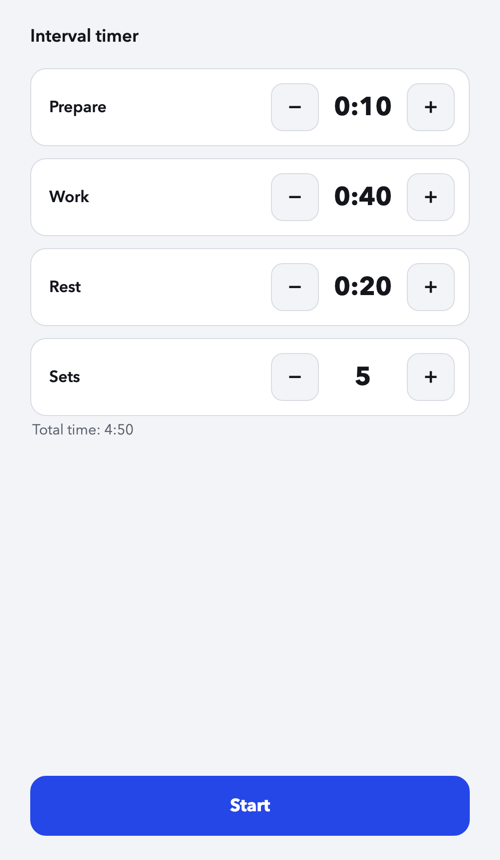
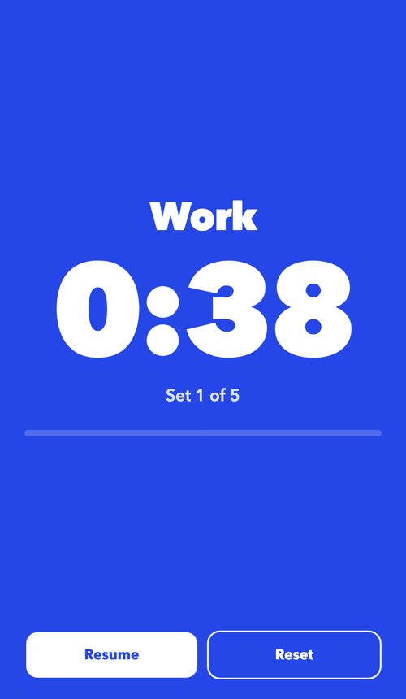

# Interval Timer

I couldn't find a free workout timer app that did what I needed without ads, subscriptions or sign-ups, so I made one myself.

It's a simple interval timer: set your **prepare**, **work** and **rest** times and the number of **sets**, hit Start, and go.

  
  &nbsp;&nbsp;
  

## Features

- Color-coded phases (get ready / work / rest) you can read from across the room
- Beeps and vibration on phase changes, plus a 3-2-1 countdown
- Keeps your screen awake during a workout
- Remembers your last settings
- Installable on your phone's home screen, and works offline

## Usage

**Use it here: https://marinarosell.github.io/workout-timer-app/**

On your phone, open the link and choose "Add to Home Screen" to install it like an app. After that it works offline too.
